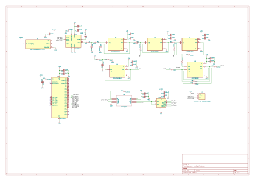

#Bioimpedance Spectrometer

A capstone project to develop a bioimpedance spectrometer using an AC current source, voltage measurement, and digital signal processing. The project is being developed by two teammates: one focusing on hardware and the other on software. Self-calibration and heart monitoring are project goals; they have not yet been demonstrated.

> **Current scope:** bench development with resistor or RC phantom loads only. Do not connect this prototype to a person. Isolation, fault-current limits, and other requirements for human use have not been verified.



## System overview

```text
ESP32 ──SPI──> AD9833 DDS ──> filter and buffer ──> Howland current pump
  │                                                        │
  │                                                  phantom load
  │                                                        │
  ├──SPI──> ADC <── INA818 instrumentation amplifier <─────┘
  └──I²C──> OLED module
```

The DDS produces a programmable waveform. The analog front end is intended to drive an AC current through a phantom and measure the resulting voltage. The ESP32 is intended to control the system, acquire samples, and display results. Impedance measurement requires knowing both the voltage and the actual current, including their phase relationship; this measurement chain is not yet complete.

## Hardware

### Main components

| Component | Intended role | Status |
| --- | --- | --- |
| AD9833 and 25 MHz oscillator | Generate the excitation waveform | Present in schematic |
| Filter and op-amp buffers | Filter and condition the waveform | Present; performance not verified |
| OPA2192 Howland current-pump stage | Drive the phantom load | Present; stability and current accuracy not verified |
| INA818 | Amplify the sensed differential voltage | Present; input and output operating ranges need verification |
| ADC122S101 | Convert analog signals for the ESP32 | Present; both input channels currently share the INA818 output |
| ESP32-WROOM-32 | Control and data acquisition | Present; firmware and complete interfaces remain to be developed |
| Four-pin I²C OLED module | Display measurements | Connector added; module and pinout not yet specified |

### Schematic and connections

- [Open the KiCad schematic](hardware/oled-update/Capstone-review.kicad_sch)
- [View the schematic as an SVG](hardware/oled-update/Capstone-review.svg)
- The OLED connector assigns pin 1 to GND, pin 2 to 3.3 V, pin 3 to SCL (ESP32 GPIO22), and pin 4 to SDA (ESP32 GPIO21). **Check the pin order, voltage, and pull-ups against the chosen module before connecting it.**
- AD9833 FSYNC is connected to ESP32 GPIO26; the DDS and ADC share SPI clock and data lines with separate select signals.
- The SVG is a picture; edit the `.kicad_sch` file in KiCad Schematic Editor.

### Hardware work remaining

- Check the INA818's input common-mode and output range, and the ADC's 0–3.3 V input range over the intended operating conditions.
- Design and verify a separate current measurement or reference channel. The two ADC inputs currently connect to the same INA818 output.
- Choose an OLED module and verify its connector pinout, supply requirements, and I²C pull-ups.
- Review the remaining KiCad electrical-rule-check messages, component libraries, and footprints; the last check reported 6 errors and 14 warnings.
- Validate the current source, voltage sensing, and full measurement chain with known resistor and RC phantom loads.
- Design and validate the calibration method. Human connection requires a separate safety design and review.

The [earlier Track A hardware notes](docs/track-a-hardware-v1.md) and [phantom notes](docs/variable-impedance-phantom-v1.md) contain proposed ideas and targets. They are planning documents and do not necessarily describe the current schematic.

## Simulation

- [LTspice schematic](simulation/bioimpedance_wired.asc)
- [Example independently calculated 50 kHz dataset](simulation/simulated_50kHz_resistive.csv)
- [Example dataset plot](simulation/simulated_50kHz_resistive.png)

The LTspice circuit is a simplified bench model using ideal amplifier substitutes and stepped resistive loads. It does not model the complete digital system, patient protection, or all real component limits. The CSV was independently calculated from the simplified circuit; it is **not an LTspice export or measured data**. Results are exploratory and do not validate the hardware.

## Software

*Teammate: add your software details here.*

### Planned responsibilities

- [ ] Describe the firmware architecture and development environment.
- [ ] Document ESP32 configuration and communication with the DDS, ADC, and OLED.
- [ ] Explain sampling, impedance calculations, and calibration once implemented.
- [ ] Add setup, build, upload, and run instructions.
- [ ] Document tests, known limitations, and example output.

## Research reference

Bassem Ibrahim, Drew A. Hall, and Roozbeh Jafari, [Bio-Impedance Spectroscopy (BIS) Measurement System for Wearable Devices](https://jafari.tamu.edu/wp-content/uploads/2019/06/08325138.pdf), IEEE BioCAS, 2017. This is a separate research paper by its credited authors; its measurements and results do not validate this project.

## References

- [AD9833 datasheet](https://www.analog.com/media/en/technical-documentation/data-sheets/ad9833.pdf)
- [INA818 datasheet](https://www.ti.com/lit/ds/symlink/ina818.pdf)
- [ADC122S101 datasheet](https://www.ti.com/lit/ds/symlink/adc122s101.pdf)
- [ESP32-WROOM-32 datasheet](https://documentation.espressif.com/esp32-wroom-32_datasheet_en.html)
- [Bioimpedance spectroscopy research paper](https://pmc.ncbi.nlm.nih.gov/articles/PMC12109311/)

